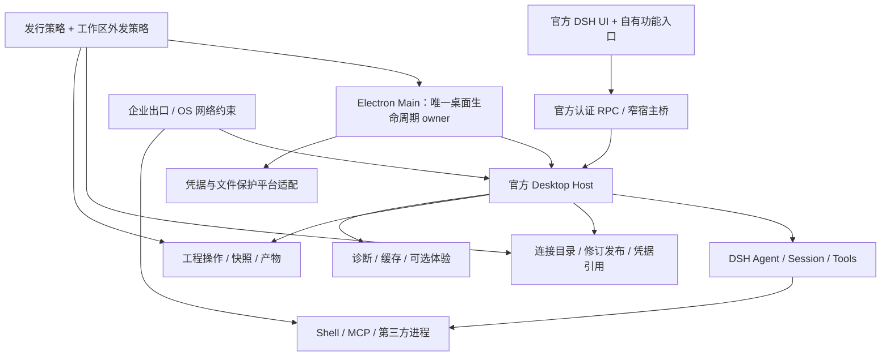

# 官方 Electron 主线迁移：源码核实与实施方案

> 2026-09-29 更新：当前执行基线为官方 `0.2.0-rc.1`，请以[新版迁移实施计划](ELECTRON-MIGRATION-PLAN-0.2.0-rc.1.md)的版本、阶段与门禁为准。本文保留历史核实事实，下面的 `0.1.7-rc.2` 不再是当前迁移目标。

核实日期：2026-09-28（Asia/Shanghai）。本文件是分析和实施规划，不是迁移完成报告。

持续跟随官方引擎、升级适配与后续功能开发，详见新增的 [上游演进方案](ELECTRON-UPSTREAM-EVOLUTION-2026-09-28.md)。该方案补充了整套发行组合升级、适配契约、补丁治理、升级演练和修订排期。

**建议：以官方 DSH Electron `dsh-v0.1.7-rc.2` 为固定起点，建立独立发行身份与内网策略，保留 DSH 唯一 Agent Loop，按行为与测试迁移现有功能。先交付 Windows x64 内网候选；Codex、ZCode、OpenCode 用来借鉴边界与协议设计，不在首版引入多个执行引擎。**

## 1. 核实范围、证据与版本

这次读取了用户附件、本地 README/版本锁/发布证据、连接热更新/快照/工程操作等关键实现；另外下载并检查了以下四份开源源码。检查集中在本次迁移边界，没有宣称全仓审计。未编译运行四个参考项目，未启动现有应用、调用真实模型、读取凭据或迁移用户资料。原有测试 PASS 属于历史证据，本次未重新执行。

| 对象 | 本次核实基线 | 解释 |
|---|---|---|
| 当前桌面仓库 | `main`，`1e8d84f` | 本地跟踪引用显示与 `origin/main` 一致；未另行刷新此远端引用 |
| 当前桌面/引擎 | `0.2.5-rc.1` / `0.1.7-alpha.2` | 以 `versions.json` 与 `build-deps/harness-source.json` 为准 |
| 本地 Harness fork | `5e2879f0478ba9336128312e715dee7a9f56c3db` | 相邻 checkout 实际存在且工作树干净；含两项定制提交 |
| 官方 DSH | `dsh-v0.1.7-rc.2` / `477b4f420553e8a52c2fbccc464d7561b239c443` | 当前公开发布页最上方版本，2026-09-24，**Pre-release**；远端 tag 与源码 checkout 对应 |
| OpenAI Codex | `1cc7e2361237ce7244430ee1d581c77f95c57ac8` | 本次取得的默认分支快照，不称为稳定发布版本；范围是开源 CLI/App Server 核心 |
| ZCode | `29628c9acdb81b703bbd4080c207a0e7ce5e276e` | 用户确认的 `zai-org/ZCode` 默认分支快照 |
| OpenCode | `v1.18.32` / `545f51d26cc39a907d2867492d498d9607ea5fa4` | 固定公开发布样本；未将混杂 V1/V2 的在线文档当成同一版契约 |

官方 Desktop `apps/desktop/package.json` 自身也为 `0.1.7-rc.2`。目前官方发布目标为 Windows x64、macOS x64/arm64；本计划不把 Linux 列入首轮交付。来源：[官方发布](https://github.com/deepseek-ai/deepseek-harness/releases/tag/dsh-v0.1.7-rc.2)、[Desktop 源码](https://github.com/deepseek-ai/deepseek-harness/tree/477b4f420553e8a52c2fbccc464d7561b239c443/apps/desktop)。

本地 [发布证据](evidence/0.2.5/distribution-verification.json) 记录独立离线目录 PASS、29,247 文件、约 1.46 GB，但 `fieldAcceptance: NOT_TESTED`，额外 SDK feedback 回放失败仍未解决，且 `remotePublished: false`、未生成 ZIP。**代码推送、运行包发布、日常长期验证是三个不同状态。** 旧发布文档中的“桌面提交未推送”与后续 README/本地 tracking 状态有时间差，实施前应统一记录，不能据旧文字判断当前分支状态。

详细源码入口和机器可读基线见 [证据索引](ELECTRON-MIGRATION-SOURCES-2026-09-28.md) 与 [基线清单](evidence/migration-2026-09-28/baseline.json)。

## 2. 对输入材料的修正

| 原有判断 | 本次源码核实 | 对实施的影响 |
|---|---|---|
| 官方必须登录/填 Key 才能进入 | `welcome-api.ts` 有 `skip()`，`main.ts` 绑定 `skip: enterWorkspace`；无身份会展示欢迎页，但已有本地跳过入口 | 保留这个能力；重点处理首次默认入口、账号监听、失效/退出登录路径，以及内网 profile 不加载无关在线模块 |
| 本地快照失败仍继续 | **不能一概而论**：`task-snapshot-integration.mjs` 对已启用且未确认的快照返回 `reject`；`change-review-integration.mjs` 的差异基线失败则继续 | 保留已有快照阻断，不重复开发；分别定义“文件保护快照”和“审阅基线” |
| 必要 fork 源码链无法核实 | 本机相邻仓库含 `dad014b7…` payload hook、`5e2879f…` catalogProvider 完整提交 | 可以本地逐项重做适配；远端可取得性仍未闭合，不能只 clone 公开桌面仓库复现 |
| 旧版靠源码字符串改写接入缓存 | 旧兼容路径仍存在；当前源码候选通过固定 hook 准入，并明确不启用旧改写桥 | 迁移时淘汰旧运行时改写路径；不能把它描述为当前候选全部行为 |
| 官方无托盘、无离线故事 | `rc.2` 有托盘、退出检查、预打包核心运行依赖；原评审基于较早 checkout | 不复制旧监督器/托盘，不重新设计核心依赖启动安装器 |
| 改 App ID 就能隔离派生版 | 官方 `paths.ts` 将 profile 放在共享 DSH home；Host 默认使用 `19387`，可通过 profile 覆盖 | 除 Electron userData 外还要隔离 `DSH_HOME`、profile、凭据、锁、端口、浏览器分区、更新与协议注册 |
| 官方热更新保证所有重试不变 | adapter 固定 profile/model snapshot，但在每次 `streamWithSnapshot()` 内解析凭据；另有 Agent 级 retry 插件 | 必须实测区分流调用、传输重试、Agent 新步骤；不能仅凭注释承诺整个逻辑请求冻结 |

这些修正不改变迁移方向，但会改变任务优先级与估算。旧的 `REVIEW-TAURI-VS-OFFICIAL.md` 保留为历史材料，本次没有覆盖它。

## 3. 四个 Harness 的可借鉴部分

### 3.1 DSH：保留核心所有权，补齐发行策略

官方已经拥有 Electron Main → Desktop Host → Cordis profile → Agent/Session/Tools 的完整路径；Host 生命周期协议版本为 4，使用 Node IPC，界面经 `dsh-app://app` 转发至经过认证的 Host。`llm-pi-ai` 支持请求级配置快照、目录和路由更新。

应复用窗口、托盘、Host 生命周期、会话持久化、上下文压缩、工具执行、原生审批、插件管理与文件预览。新增功能通过 Cordis 服务、原生 RPC 和 UI 扩展点接入；只有发行入口、身份、凭据宿主桥、必要扩展契约属于有意识维护的派生补丁。

特别注意：官方 `loader/volatile-update` 回调捕获路由冲突后只记录日志。桌面不能把 `settings.replace()` 返回当作“所有路由生效”的确认。源码：[llm-pi-ai/index.ts](https://github.com/deepseek-ai/deepseek-harness/blob/477b4f420553e8a52c2fbccc464d7561b239c443/packages/llm/llm-pi-ai/src/index.ts)。

### 3.2 Codex：借鉴明确的任务协议和可撤销网络权限

公开 App Server 提供 thread/turn/item 层次、双向审批、开始/中断/恢复等接口。所读开源源码还有独立的应用网络策略：已授权请求持有 permit，策略改变可撤销在途许可；策略不可用、目的地不允许和已撤销是不同错误。

建议移植这些设计思想：请求/任务/执行代际 ID、幂等命令、明确取消结果、审批 owner、策略撤销与普通网络失败区分。**不复制 Codex 整个沙箱或把其协议替换为 DSH 核心协议**。若以后接 Codex 后端，应使用官方 App Server，并通过能力声明接入独立任务。

有必要区分执行接口：官方文档中 `command/exec` 与 `thread/shellCommand` 的沙箱语义不同，后者不继承线程沙箱。不能把它们都映射为“受保护构建”。来源：[App Server 文档](https://learn.chatgpt.com/docs/app-server)、[开源网络策略](https://github.com/openai/codex/blob/1cc7e2361237ce7244430ee1d581c77f95c57ac8/codex-rs/http-client/src/network_policy.rs)。

### 3.3 ZCode：最值得参考的是配置发布和多客户端一致性

`ProviderRegistryService` 合并 config/account 来源，记录双方修订；当 account 基于旧 built-in revision 时继续服务上一份完整 Registry，等来源一致后才替换。它还合并并发刷新，避免旧异步结果覆盖新状态。

`zcodeAgentConnectionScope.ts` 将订阅归属绑定到实际连接，剥除 UI 伪造的 connection/mode 等字段；Host 只转发 CLI 事实。`zcodeProtocolClient.ts` 区分观察请求、操作请求、超时与 pending 排空。这些直接适用于你的多窗口状态、热应用回执和草稿追加确认。

建议借鉴实现方式，不移植整个 ZCode services 层。它自身也有在线配置同步、后台任务、日志和独立凭据实现，不能当作天然内网底座。来源：[Registry](https://github.com/zai-org/ZCode/blob/29628c9acdb81b703bbd4080c207a0e7ce5e276e/packages/provider/src/registry-service.ts)、[连接作用域](https://github.com/zai-org/ZCode/blob/29628c9acdb81b703bbd4080c207a0e7ce5e276e/packages/services/src/zcode-agent/zcodeAgentConnectionScope.ts)、[NOTICE](https://github.com/zai-org/ZCode/blob/29628c9acdb81b703bbd4080c207a0e7ce5e276e/NOTICE.md)。

### 3.4 OpenCode：参考提供方表达、权限规则与差异审阅

固定版本中 provider/model 身份分开，支持多种协议和 SDK；权限系统有等待用户回复的 pending 状态；快照服务采用独立 Git 目录、按项目/工作树划分并提供 diff/revert。

但其配置更新 handler 会标记 instance disposal，不能据此推断你的“在途继续、下次请求切换”要求已经满足；provider 实现还允许 `Npm.add()` 动态安装，模型目录会周期刷新。迁移内网功能时不能带入这些默认运行时下载行为。

它的 Git 快照适合借鉴变更审查 UX，不能取代你对非 Git 文件、指定路径和 NTFS 文件身份的保护。来源：[配置更新](https://github.com/anomalyco/opencode/blob/545f51d26cc39a907d2867492d498d9607ea5fa4/packages/opencode/src/server/routes/instance/httpapi/handlers/config.ts)、[Provider](https://github.com/anomalyco/opencode/blob/545f51d26cc39a907d2867492d498d9607ea5fa4/packages/opencode/src/provider/provider.ts)、[快照](https://github.com/anomalyco/opencode/blob/545f51d26cc39a907d2867492d498d9607ea5fa4/packages/opencode/src/snapshot/index.ts)。

### 3.5 选型结论

| 方向 | 建议 | 原因 |
|---|---|---|
| 官方 DSH 派生 + 本地增量模块 | 采用 | 符合已确定产品路线，最大程度继承上游功能 |
| 把现有 Tauri 全量重写成另一套 Electron 壳 | 不采用 | 重复官方生命周期，还要维护旧 UI/引擎接入 |
| 第一版同时接 DSH/Codex/ZCode/OpenCode | 暂缓 | 审批、恢复、会话格式、工具执行归属差异会压过迁移工作 |
| 第一版预留多后端能力描述和任务交接格式 | 采用小范围设计 | 为以后扩展留边界，不提前实现通用 Agent 平台 |

## 4. 目标结构与维护方式



建议后续在现有 Harness fork 上建立独立 `codex/electron-intranet` 分支，以固定官方 tag 起步；在独立 checkout 开发，保留当前 `codex/tauri-integration` 和旧交付。最终 Electron 主线放在官方 monorepo 内，以减少跨仓构建拼接。旧桌面仓库用于冻结迁移来源、历史证据和旧版维护，避免两套新功能主线。

自有代码建议集中到一个明确命名空间，概念模块为 `distribution-policy`、`desktop-bridge`、`connections`、`workspace-policy`、`engineering`、`file-protection`、`observability`、`pet`。具体包名在 M0 适配现有仓库规范；不要先创建一大批空包。

每个上游补丁登记目的、触点、测试、预期删除条件、upstream tag。两项旧 fork 补丁须逐项适配 `rc.2`：本次该 tag 的 `llm-pi-ai` 没有旧 `catalogProvider` 和 `preparePayload` 契约，不能只改版本锁或假设无冲突 cherry-pick。目录继承继续保留完整模型兼容字段；payload hook 必须有明确数据所有权、失败行为和按请求隔离。

DSH 和 OpenCode 所读根许可证为 MIT；Codex/ZCode 为 Apache-2.0。实际复制代码时记录出处、修改和适用 NOTICE，核对第三方文件例外。首轮优先借鉴设计以保持依赖轻量。

### 一个主线、两份发行清单

| 项目 | 内网受控包 | 个人联网包 |
|---|---|---|
| 本地入口 | 默认直接进入 | 默认直接进入 |
| 官方账号模块 | 默认不加载 | 可选加载 |
| 更新 | 人工导入完整验证包/批准的内网源 | 自有可选更新源 |
| 外联 | 受管理员策略约束的目的地 | 用户连接范围 + 工作区限制 |
| Google 模块 | 默认不加载 | API/人工交接；自动订阅后端待准入 |
| 依赖安装 | 仅构建端或审核离线扩展包 | 显式安装且受网络/权限限制 |
| 身份与数据 | 独立 namespace | 与内网 namespace 分开 |

受控模式不能是工作区配置可自行关闭的开关。建议权限组合使用交集：发行限制 ∩ 管理员规则 ∩ 工作区外发范围 ∩ 本次授权；凭据存在只表示可以认证，不表示允许发送工作区资料。

## 5. 内网底座的具体修改

### 5.1 本地可用性、账号和更新

在 Main 的启动/恢复/登出路径注入发行策略，内网模式不创建官方账号监听、远端账户视图、自动更新调度和强制更新控制器；Host profile 同时排除对应在线插件。避免只改 UI 按钮后后台照常请求。

保留官方本地 Host 认证：它用于阻止本机未授权进程/页面调用 Host，与是否登录 DeepSeek 账号无关。不得为了免账号取消 Host cookie、frame/origin 校验或 renderer sandbox。

官方强制更新请求失败保留当前已知 block；打包环境验证在 unsigned 分支之前检查 policy。因此发行策略必须进入构建与运行两条路径。内网包缺少官方配置应合法，自有更新验证仍应生效。第一轮离线升级可采用“校验新完整包 → 退出 → 新目录启动”，不必立即实现自更新器。

### 5.2 身份和并存

隔离 App ID、名称、安装目录、Electron userData、`DSH_HOME`、profile/数据库/附件、凭据命名空间、单实例锁、浏览器分区、更新通道及可注册的协议。官方 Host 默认 `19387`，官方文档支持 `webserver.config.port` 覆盖；先验证 profile 配置能否满足自有 loopback 端口与认证 launch URL 要求，确有缺口再改 Host。纳入与官方版/旧版同时运行的验收，否则“独立 App ID”仍可能发生端口冲突。

### 5.3 外联控制

维护可审查的网络调用面清单：Electron session、Node HTTP/WS、模型 SDK、模型目录/连接测试、账号刷新、更新、插件/MCP、远程预览图片、外链、shell/git/包管理器、诊断上传。UI 背后的辅助模型（标题、摘要、识图等）同样适用。

网络条目按用途、调用模块、scheme、规范化 host、port、必要路径规则与工作区约束匹配。默认拒绝未经批准目的地；redirect 逐跳检查，跨 origin 不携带原鉴权；拒绝 URL 内嵌用户名密码。内网 HTTP 若确有需要应精确批准，不能简单复制只支持 HTTPS 的参考实现，也不能全局禁用 TLS 校验。

应用级限制不等同于 OS 防火墙。对任意 shell/MCP/原生组件的严格网络承诺需要受控出口代理或系统网络策略；无法提供时，验收只能标明“应用已知出口受控，任意子进程出口未认证”。新增外联测试必须从实际打包 EXE 收集证据。

**策略撤销优先于热切换连续性。** 普通编辑连接允许旧请求完成；管理员撤销服务许可、工作区级禁止外发或密钥紧急撤销时，取消受影响在途请求并拒绝重试。这两个行为不能混为一个“永不中断”。

### 5.4 离线依赖和凭据

随包固定 Electron/Host/core plugins/原生组件以及被选中的辅助运行时。构建输入含完整 SHA、锁文件、目标架构、许可证、完整性清单和构建回执；现场禁止 npm/pnpm 自动补装，缺组件时给出具体离线包要求。

主连接继续使用 OS 凭据后端和引用；识图当前走 Harness 本地 YAML 服务，迁移时一起治理，不能笼统声称所有 Key 已受凭据管理器保护。事务使用版本化的密文封装，失败时保持旧可用状态；跨机器导入设置不等于能解密另一用户的 DPAPI 数据，应明确要求重新授权/输入。

首轮 Windows 可保留现有 Win32/DPAPI 能力，通过窄接口调用。后续跨平台再实现 macOS/Linux 后端；不能只换成普通 JS 文件复制就删除已有的文件句柄、重解析点、路径身份保护。OS 安全存储不可用时不静默持久化明文。

## 6. 连接热切换：必须落实的契约

### 6.1 产品语义

| 用户动作 | 生效范围 | 需要展示的边界 |
|---|---|---|
| 改同一连接 Key/地址/模型参数 | 下一个获准发出的逻辑请求 | 在途用旧修订；改变目的地还需重新检查工作区外发范围 |
| 改默认连接 | 新任务及尚无显式选择的任务 | 不悄悄改历史会话 |
| 当前任务切到另一服务 | 安全请求边界后的继续执行 | 显示目标服务与将发送的上下文范围；不能只检查“点击切换”时刻 |
| 切代理/CA | 第一阶段确认后受控重载 | 界面明确“需重载”；后续才做连接级 transport |
| 换 Harness 后端 | 新的关联任务/显式交接 | 不承诺原对话、审批和工具状态无损续接 |

模型主键采用 `(connectionId, modelId)`，路由由稳定 connection ID 派生，显示名可改。编辑 Base URL 也可能转移数据目的地；即使连接 ID 没变，也要在提交与实际发送前做策略判断。

### 6.2 最小数据契约（设计草案，不是现有接口）

```text
ConnectionRevision
  connectionId, revision, protocol, baseUrl
  credentialRef + credentialRevision
  modelCapabilities + catalogRevision
  networkProfileId + networkRevision

RequestLease
  logicalRequestId, taskId, turnId, connectionRevision
  credentialLease, transportLease, policyRevision
  retryGroupId, released

ApplyResult
  operationId, hostEpoch, desiredRevision, appliedRevision
  routeDigest, status = applied | rejected | unknown
  errorCode, requiresReload
```

lease 内可持有敏感值，但 UI 回执和日志只能持有非敏感标识。不要用可枚举的 Key hash 充当日志标记；继续采用受控 HMAC/不可逆随机身份。

### 6.3 应用状态机

`draft → validated → staged → published → verified`；前两步拒绝无效输入；发布中出现未知结果则查询实际修订，不重复发送有副作用操作。

具体实现要求：

1. 配置写入由一个 owner 串行化，带 expectedRevision/CAS，避免两窗口丢更新。
2. 先准备不可变凭据、模型与网络修订，验证目录和路由冲突，再发布；默认选择在路由确认后发布。
3. settings、credentials、路由不是天然跨存储原子事务：用 journal 记录 prepare/commit/reconcile，恢复时查实际状态；不能用两个 `replace()` 假装原子提交。
4. 成功回执核对实际 adapter 路由、默认模型和修订。若官方没有足够 introspection，增加窄接口，而非一次真实模型请求来证明配置生效。
5. 同一个逻辑请求的自动重试保留旧 lease；Agent 工具结果后的新模型请求才可取得新修订。若上游 retry hook 无法保持该语义，需小范围核心 seam 或推迟该能力，不静默改语义。
6. 退役修订在当前配置不再引用、在途与重试 lease 归零后回收；删除连接不删历史任务。持久凭据删除需考虑回滚窗口。JS 内存不承诺物理清零，目标是去除可达引用并限制保留时间。
7. 正常取消等待 terminal 状态和租约释放；超时为 unknown，不等于远端未执行；不自动重放工具、提交或上传。

### 6.4 跨代理/CA 的后续版本

优先验证官方 SDK 是否支持 per-request transport/dispatcher；可支持则按 `(connectionId, networkRevision)` 建池，不改进程环境变量。无法隔离的 SDK 可使用专用传输 worker，但 worker 不运行另一套 Agent Loop。旧池排空后释放；CA 不同的连接不能复用同一个未经隔离的代理实例。

## 7. 现有功能的迁移映射

| 功能 | 当前主要实现 | 新落点与要求 | 阶段 |
|---|---|---|---|
| 连接/模型 | `source-provider-control.mjs`、`source_providers.rs`、`profiles.rs` | Connection service + 官方模型目录；实际生效回执、凭据租约 | M2 |
| 配置/数据迁移 | `source-settings-migration.mjs`、`workspace-migration.mjs`、`settings-transaction.mjs` | 自有数据根，复制导入，版本化 journal，未知格式拒绝 | M1–M2 |
| 工程环境/Git/Hg | `environment-repository.mjs`、`desktop-environment` | 官方 UI 插槽 + 工程服务；保留 Git 写操作的预览/状态重检 | M3 |
| 差异/草稿 | `change-review*`、`change-draft.mjs` | 官方 composer adapter；绑定 window/session/draft revision，幂等追加 | M3 |
| 构建测试 | `project-actions*` | DSH 执行/审批后端；信任绑定配置摘要和工程身份 | M3 |
| 快照恢复 | `task-snapshot*`、Rust `task_snapshots` | 独立必需保护服务；保留确认阻断和文件身份校验 | M3 |
| 产物 | `desktop-artifacts.mjs`、`artifacts.rs` | Host 查询 + 原生打开/保存；保留声明/发现/已验证来源区别 | M3 |
| 恢复/通知 | `task-recovery*`、notifications | 官方生命周期与本地扩展状态合并 | M3 |
| 只读诊断 | `diagnostic-*`、`desktop-observability` | 独立插件，禁用不影响连接/保护 | M4 |
| 缓存与实验 | `source-cache.mjs`、`cache-*`、`source-profile.mjs` | 单独策略插件，受控 hook，token 预算 schema 升级 | M4 |
| 自检/识图 | `self-test-*`、`vision-provider.mjs` | 统一凭据/外联；本地检测与真实服务探测分离 | M4 |
| 桌宠/主题 | `pet-*`、`pets.rs`、theme | 可选低权限 UI；仅订阅任务状态 | M4 |

**不做全量 Rust → TypeScript 重写。** 现有文件保护中的 Win32 句柄与身份检查可抽成受 Main 管理的窄本地 helper 或平台库。它只负责受限文件/凭据操作，不拥有 Host 启停、Agent Loop 或第二套任务状态；这样既保留安全行为，也避免双监督器。

### 几个必须先解决的兼容问题

- `source-profile.mjs` 的 `maxInlineBytes` / `effectiveSpillBytes` 与 `rc.2` 的 `maxInlineTokens` 不同。不能把 50,000 bytes 直接当 50,000 tokens；记录新单位和 tokenizer/估算方式，旧实验数据保留旧 schema 并标记不可直接比较。
- 旧 HTTP POST 校验 `Origin === http://Host`，官方转发删除 Origin 并附 Host cookie；迁移为认证 RPC 或框架内同等强度路由。不能简单接受所有无 Origin 请求。
- `desktop-observability` 当前同时装载快照、工程、自检等核心功能；应拆装载边界。只读诊断异常不能让必需桥接或文件保护消失。
- 当前快照 pre-step 跳过 `origin === subagent`，且 pipe 禁用时不执行保护；差异基线又是尽力记录。必须把子任务、项目动作、独立终端和外部 Agent 的覆盖范围做成明确矩阵。
- 默认严格范围建议以工作区写操作 lease 保护；父子任务可继承保护租约，避免每个子任务重复快照。并发写入要串行、独立 worktree 或明确拒绝；不能靠某一次 pre-step 截图式快照声称所有后续写入已保护。

## 8. Google AI Pro / Antigravity 的独立安排

Google AI Pro 的 Antigravity 权益、Gemini API 项目计费和第三方集成许可要分别判断。本次打开的 Antigravity 条款第 6 条明确限制第三方软件访问，包括第三方使用其 OAuth；页面同时列有企业/特定订阅适用条款的例外，不能把消费订阅限制泛化到所有合同。当前不能据“CLI 可 headless”承诺你的 DSH 可稳定消费个人订阅额度。来源：[当前条款](https://antigravity.google/terms)、[计划说明](https://antigravity.google/docs/plans)、[Gemini API 计费](https://ai.google.dev/gemini-api/docs/billing)。

建议产品安排：

1. 个人包实现 Gemini API 连接，标明项目计费来源，配额用尽不自动切换收费线路。
2. 支持本地任务交接包：目标、选定文件清单、基线 commit/文件摘要、允许导入的结果范围。由用户在官方客户端执行，返回后以 diff/产物审查导入。
3. 订阅自动化后端保持条件项：取得适用许可、核对协议与实际账号权益后再启用。不把 OAuth 令牌导出、伪装客户端或中转代理作为主线依赖。

`agy` headless 文档确实有流式 JSON/恢复，但不接受通用 `control_request/control_response`；不能自动获得 DSH 的审批语义。将来接入时须标记后端能力，不支持逐工具审批就不要显示为支持；文件操作由独立工程副本和审查保护。来源：[headless 协议](https://antigravity.google/docs/cli/headless/)。

这条安排**尚未满足“直接在 DSH 消费 AI Pro 的 Antigravity 额度”**，必须在功能表中保留为未交付，不能用 API Key 接入替代验收。它也不阻塞内网主线。

## 9. 实施工作包、依赖和退出条件

以下为单名熟悉仓库的开发者、Windows x64 优先、已有构建环境的工作量估计，非承诺日期。每个阶段以通过门禁为完成依据；M0 结束后重新估算。

| 阶段 | 工作量估计 | 主要任务 | 必须交付的证据 |
|---|---:|---|---|
| M0 来源与接缝验证 | 3–5 人日 | 固定上游；封存两项 fork 补丁；接口清单；官方空白包构建；离线基线 smoke | 新 checkout 可取得全部输入；补丁差异表；包内完整性记录；关键接口原型结论 |
| M1 内网发行底座 | 6–10 人日 | 自有 identity/DSH_HOME/端口；本地入口；账号与更新策略；profile 裁剪；外联清单；离线依赖与更新校验 | 空 home、无账号/Key、无公网可进入；官方版并存；只放行 mock/内网目的地 |
| M2 连接与迁移 | 7–12 人日 | 多连接、两协议、模型目录继承、凭据后端、事务/CAS、修订租约、实际回执、副本导入 | 长请求切换、重试不串 Key、冲突/超时恢复、凭据退役、未知数据拒绝 |
| M3 工程闭环 | 10–16 人日 | Git/Hg/草稿；构建取消与产物；文件保护 helper；任务恢复/退出确认 | 真实样例工程完成修改—构建—审阅—交付；保护失败阻断；子任务/并发覆盖 |
| M4 诊断与体验 | 6–10 人日 | 诊断拆分；缓存/预算 schema；A/B、自检、识图、桌宠、主题 | 禁用辅助插件仍能工作；导出脱敏；两协议真实 payload 合约；视觉检查 |
| M5 发行资格 | 4–7 人日 | 干净机/企业目录；升级回滚；负载/睡眠；现场内网；签名与交付文档 | 最终 EXE 对应构建回执、现场证据和完整包一致 |

关键路径：`M0 → M1 → M2 → M3 → M5`；M4 可按实际优先级分批交付，但“完整功能迁移”必须包含它。总量约 **36–60 人日**，加 20% 不确定性约 43–72 人日；等待证书、企业镜像/出口、Google 许可和 macOS/Linux 适配不在该估算内。M2 完成只是内网连接候选，M3 加核心 M5 门禁后才进入工程日用试用。

### M0 应立即实施的最小垂直切片

在独立候选目录做出：自有数据根 → 无账号进入 → 配置一个本地 mock → 发送一次带工具调用的任务 → 请求暂停期间改 Key → 下一请求核对修订 → 关闭窗口继续 → 正常退出 → 重开历史不重放。只用合成文件与 Key。

同时确认四个技术风险：两项 fork 补丁在 rc.2 的替代接缝、路由 introspection、重试租约边界、文件保护 helper。若其中有阻断，先修架构与估算；不要先迁全部设置页面掩盖底层缺口。

### 建议的提交拆分

`source-baseline` → `distribution-policy` → `isolated-identity` → `offline-package` → `credential-bridge` → `connection-revisions` → `data-import` → `engineering-services` → `file-protection` → `diagnostics` → `optional-ui` → `release-qualification`。

每个提交/PR 必须说明行为变化、上游触点、数据影响、测试边界和回退方式。变更 upstream pin 时先在隔离候选重放合约与迁移 fixture，再更新主线；不追浮动 master。

## 10. 验收矩阵

统一状态为 PASS / FAIL / UNKNOWN / SKIPPED，必需门禁的 UNKNOWN/SKIPPED 不能折算 PASS。每条记录构建 ID、源码 SHA、包 hash、OS、网络策略摘要、输入 fixture、预期、实际、日志来源与遗留问题。

| ID | 场景 | 必须满足 |
|---|---|---|
| NET-01 | 全新用户目录、无账号/Key、全断网 | 本地工作区/设置可用，模型不可用原因明确，无后台安装 |
| NET-02 | 仅放行指定内网服务 | 模型、识图、目录发现、诊断探针均受规则约束；未批准请求为零或被记录拒绝 |
| NET-03 | 更新服务错误/阻断/不可达 | 内网工作不依赖官方更新响应；自有无效离线包仍拒绝 |
| NET-04 | redirect、remote image、外链、MCP、shell/git | 分别验证调用面；严格子进程保证要有系统/网关证据 |
| ISO-01 | 官方版、旧版、新版同机并存 | 数据、锁、端口、协议与凭据不串；不导入即不写旧目录 |
| PKG-01 | 无全局 Node/npm、最小 PATH、无缓存 | 完整包首次/再次启动；缺工程工具链准确报告 |
| CON-01 | A 长请求时修改 Key/endpoint | A 使用旧 lease；新请求使用批准的新修订；PID 无需变更 |
| CON-02 | A 重试退避时修改配置 | 同逻辑请求不串 Key/策略；工具结果后的新请求按新修订 |
| CON-03 | 两连接同名模型、多窗口同时编辑 | 路由/能力/凭据/用量分离；过期 revision 拒绝 |
| CON-04 | 路由冲突、第二次写失败、丢回执 | 不误报成功；未知状态查询；不重复副作用 |
| CON-05 | 连接删除、旧请求结束、凭据轮换 | 退役引用最终回收，历史会话仍可读，回滚一致 |
| CON-06 | 政策撤销/未批准新 endpoint | 拒绝新请求并撤销受影响在途请求；不降级为网络重试 |
| DATA-01 | v3/v4/未知代资料、附件、重复导入 | 只写副本；未知代拒绝；重复导入幂等；原目录逐字节不变 |
| DATA-02 | 写入中断、磁盘满、锁遗留 | journal 可恢复；无法判定时停止修改并保留证据 |
| ENG-01 | 构建、取消、后台子进程、退出 | 实际作业被列出；终止边界明确；不残留受管进程 |
| FILE-01 | 快照失败/超时、保护服务缺失 | 已启用的保护拒绝相关执行；不能当作关闭保护 |
| FILE-02 | junction/符号链接/硬链接/路径替换 | 目标与批准身份一致，超范围拒绝；Windows 专项测试保留 |
| FILE-03 | 子任务、并发任务、独立终端、外部 Agent | 显示实际覆盖与租约关系；未覆盖不能显示“已保护” |
| UI-01 | 多窗口/主子会话/附件并存的草稿追加 | 目标正确，保留原草稿与附件，重复/迟到回执不重复插入 |
| MOD-01 | 关闭诊断/桌宠/缓存实验 | 基础工作与保护持续；只读诊断开关不改变发往模型的 payload |
| BUD-01 | 超预算工具结果、缓存字段、模型能力 | 使用 token 单位；spill 内容可恢复；双协议实际 wire 验证 |
| GOOGLE-01 | 无登录、失效、额度耗尽 | 内网连接不受影响，无自动外发和收费 fallback |
| FIELD-01 | 真实企业网关和目标 D 盘目录 ACL | 实地验收；临时目录/mock PASS 不能替代 |

测试分层：快速合约/状态机 → 真实 Host + loopback 双协议 → 打包 EXE 与 OS 行为 → 干净机/现场。优先复用已有 `source-provider-wire`、`task-snapshot-wire`、`change-review-wire`、API negative、迁移/恢复 fixture，重写的是宿主适配与新增语义，不是全部测试。

## 11. 发布、数据回退与后续决策

二进制回退和数据回退必须分开：新版可能写新会话代或数据库 schema，不能用旧 EXE 打开已经迁移的活动目录。升级前保留完整数据副本与清单；回退使用旧程序和升级前副本，明确升级后新增任务不会自动合并。工作区源文件是另外一类数据，应用数据备份不等于工程回滚。

推荐按“功能证据齐全的小批次候选 → 日用试用 → 现场资格”推进，不立即覆盖 0.2.0/0.2.5 目录。可在 M0 后选择功能降级范围，但不要降低数据/凭据/保护门禁。

本规划采用的默认决策：Windows x64 首发；单 DSH 执行后端；两种发行策略；旧保护能力保留；代理/CA 先允许受控重载；Google 订阅后端独立待准入。后续真正影响排期的输入是目标内网网关/认证/TLS 形式、是否要求不同代理并存零重载、macOS/Linux 优先级，以及必须随包提供的工程工具链。这些不妨碍先完成 M0。

## 12. 增补：可持续升级也是迁移交付项

根据后续需求，正式迁移验收新增：发行组合 manifest、上游耦合与补丁台账、集中适配边界、升级影响报告及至少一次跨官方版本的隔离演练。默认按官方 Desktop/Host/DSH/Web/运行时整套组合升级，连接热切换不扩展为引擎热替换。

后续普通功能在产品主线增量开发，上游升级走隔离候选；通过合约、数据、内网与实际包门禁后合回。可选模块失败可停用，凭据、认证、外联与已启用保护的关键契约失败则限制相关执行。上游提供等价能力时验证并退役重复补丁。

完整设计、版本策略、U0–U7 流程及 UPG-01/02/03 门禁见 [上游演进方案](ELECTRON-UPSTREAM-EVOLUTION-2026-09-28.md)。这一增量建议预留 5–9 人日，原 36–60 人日修订为 41–69 人日；加 20% 不确定性约 49–83 人日。此处修订后的估计优先于第 9 节原始估计，M0 后再校准；现阶段没有执行升级演练。
